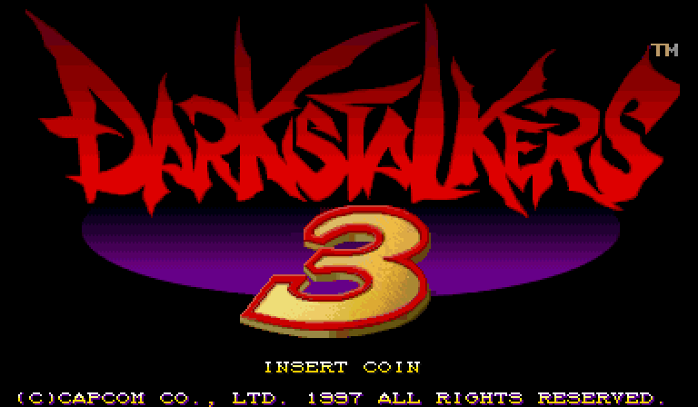
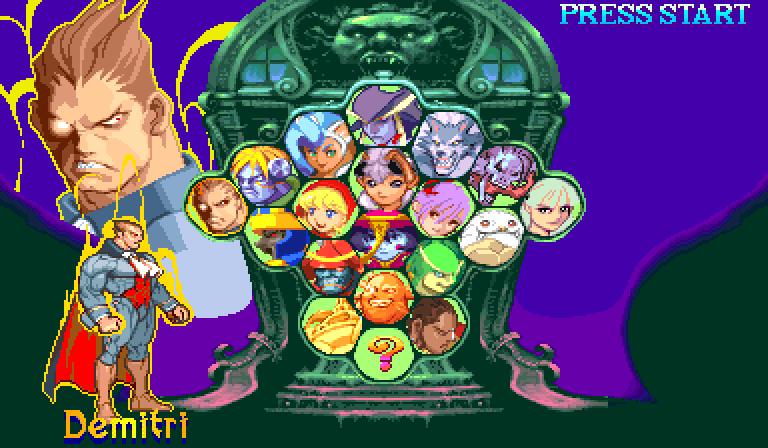
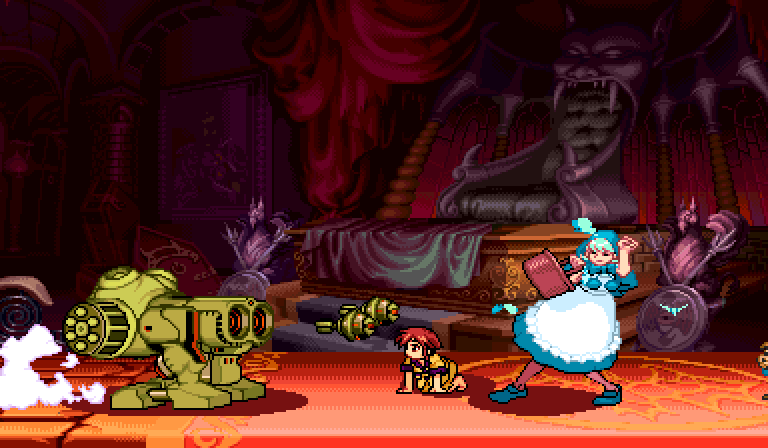
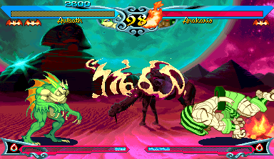
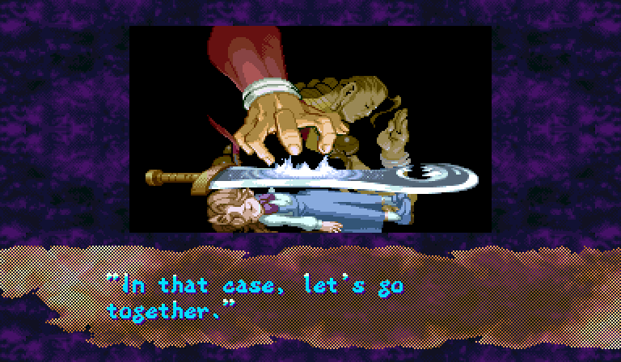
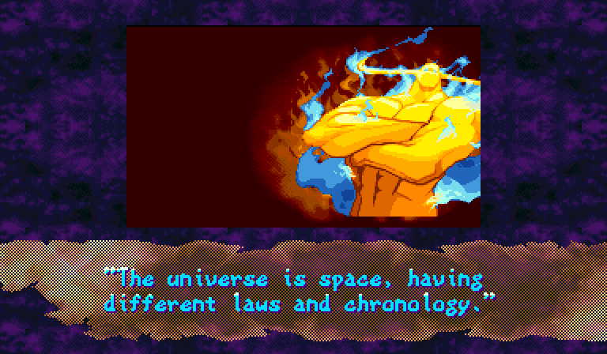
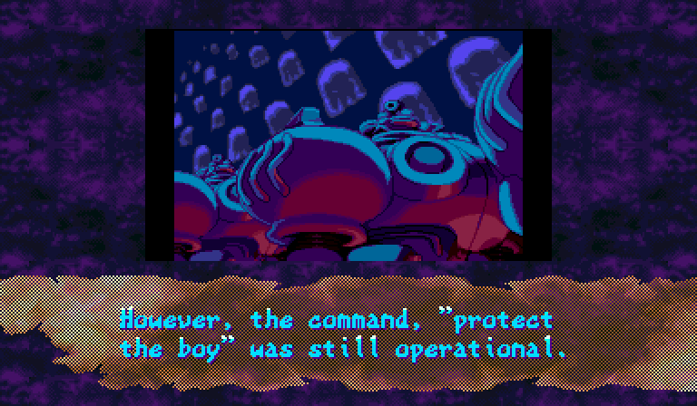
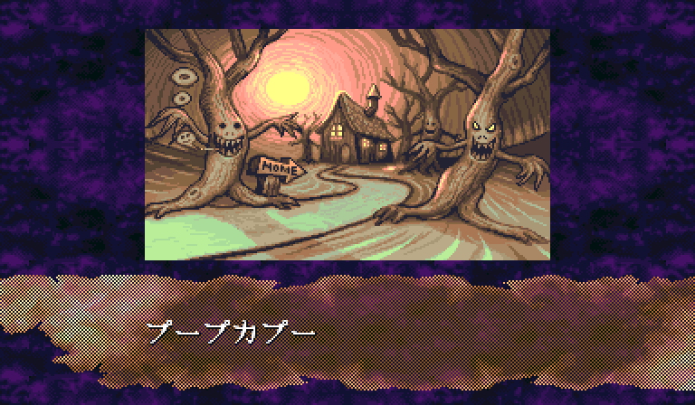
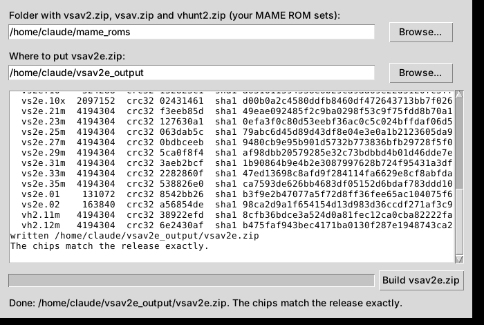

# Darkstalkers 3 (vsav2e)

**Vampire Savior 2 with the full roster of 18 Darkstalkers, English and Japanese, per-character
endings and the PlayStation title screen: a CPS2 bootleg for MAME / mame2003-plus.**

*Darkstalkers 3: Vampire Savior 2 – The Lord of Vampire* (`vsav2`) is missing three fighters that
*Vampire Hunter 2* (`vhunt2`) has, it only speaks Japanese and it gives every character the same
ending. vsav2e puts all of that back in one set, so the arcade game finally plays like the
PlayStation *Darkstalkers 3*.





## What you get

- **All 18 Darkstalkers in one set.** Jon Talbain, Rikuo and Sasquatch (from *Vampire Hunter 2*) join the
  Vampire Savior 2 cast, playable and as opponents, with their voices and their own stages. The select
  screen is laid out like the PlayStation game's, with all 18 portraits.
- **Multi-language: English and Japanese.** Menus, win quotes, Jedah's speech, character names and all
  the endings are in English (the official texts of the PlayStation *Darkstalkers 3*, with the Western
  names: Jon Talbain, Rikuo, Lord Raptor, B.B. Hood, Hsien-Ko, Huitzil...) and in Japanese. English is
  the default; the language is chosen from the service menu (*Configuration > System > Language*).
- **A real ending for every character.** Vampire Savior's endings (pictures, animation, text, music) are
  back for 14 fighters, and Donovan, Huitzil and Pyron, who had none in the arcade, get endings rebuilt
  from the Saturn's pictures and the PlayStation's English text, with music remixed from their own stage
  themes. Jedah keeps Vampire Savior 2's own ending. After each ending come the staff credits, the
  ranking and the continue screen.
- **The PlayStation title screen** (logo, zoom and flash), European region.
- **Stage select in versus:** the challenger who joins picks the stage on the portraits (each
  character's stage, "?" for random, ten-second countdown); a loser who continues starts from the last stage.



| | | |
|---|---|---|
|  |  |  |

### The roster

Demitri, Morrigan, Felicia, Victor, Anakaris, Bishamon, Lord Raptor, Q-Bee, Lilith, B.B. Hood, Hsien-Ko,
Donovan, Pyron, Huitzil, Jedah (Vampire Savior 2) and **Jon Talbain, Rikuo, Sasquatch** (Vampire Hunter 2).

### Endings

| | |
|---|---|
|  |  |
|  |  |

Donovan (Anita and the Dyrek blade), Pyron (the throne over the galaxy) and Huitzil (the machines and the
city) are new; the last picture is B.B. Hood's ending in Japanese. Details in `docs/endings.md`.

## Making the ROM

The repository and the releases hold no game ROMs. You make `vsav2e.zip` from your own MAME sets:
`vsav2.zip` (with its decrypted clone), `vsav.zip` (Vampire Savior, Europe, with its decrypted clone) and
`vhunt2.zip` (Vampire Hunter 2).

### The Windows builder (easiest)

Download `vsav2e-builder.exe` from the [latest release](../../releases/latest), run it, choose the folder
with your three MAME sets and the folder for the result, and press **Build vsav2e.zip**. It takes about a
minute. The pictures, texts and tools the build needs are inside the program, nothing is downloaded or
sent, and at the end it tells you if the chips match the release's checksums.



(`SHA256SUMS.txt` in the release has the program's checksum; `docs/builder.md` explains how it is made.)

### From the sources (any system)

Python 3.8+ and Pillow; no assembler (the assembled code is committed as hex):

```
pip install pillow
python make_vsav2e.py ROM_FOLDER OUTPUT_FOLDER
```

It writes `OUTPUT_FOLDER/vsav2e.zip` and `vsav2e.checksums.txt` (CRC32 and SHA-1 of each chip). The build
is deterministic. The program in the `.zip` is a stock `vsav2` plus a 2 MB extension, new sprite and scroll
ROMs, a larger sound program and Vampire Hunter 2's second half of the samples.

### Running it

Put `vsav2e.zip` next to `vsav2.zip` in the ROM folder of a [mame2003-plus](https://github.com/zanac/mame2003-plus-libretro)
core that has the `vsav2e` driver (the target is the upstream core; until then, the fork).

## Documentation

| Path | What |
|---|---|
| `docs/analysis.md` | measurements of the two ROM sets: what differs, what each character weighs, what can be freed |
| `docs/roster.md` | how Jon Talbain, Rikuo and Sasquatch are put back, the hardware it takes, how it is tested |
| `docs/text.md` | where the texts are and how they are translated; the language menu |
| `docs/endings.md` | the per-character endings (moved from Vampire Savior) and the new ones of Donovan, Pyron and Huitzil |
| `docs/title.md` | the Darkstalkers 3 title screen |
| `docs/versus.md` | the stage choice of a versus match |
| `docs/builder.md` | the Windows builder and the release workflow |
| `docs/psx.md`, `docs/saturn.md` | tools and notes for the PlayStation and Saturn games the pictures and texts come from |

Sources: `make_vsav2e.py` (the build), `tools/build/` (its steps: region, language, win quotes, endings, roster,
select screen, title screen, sound, names, versus stage), `tools/dev/` (the assembly sources of the routines the
build writes as hex, the test runner, working scripts), `tools/cps2/`, `tools/psx/`, `tools/saturn/`,
`tools/trace/`, `tools/analysis/` and `tools/builder/` (the Windows program). `assets/` holds the pictures
the build takes from the PlayStation and Saturn games (select screen, title, endings).

## Running the tracer (development)

MAME 0.264 or later, the sets in `roms/` (`vsav2.zip`, `vhunt2.zip`; the QSound DSP ROM
`dl-1425.bin` in `roms/qsound_hle/` — a placeholder of the right size is enough, sound is
not needed). Outputs go to `work/`.

```
tools/trace/force.sh vhunt2 02 talbain      # fight as character 0x02, trace 6000 frames
tools/trace/endrun.sh vsav2 05             # auto-win to character 0x05's ending
```

## Legal

Darkstalkers and Vampire Savior are trademarks of Capcom. This is a fan project, not affiliated with or
endorsed by Capcom, Sony or Sega. No ROM of any game is included: bring your own dumps. The pictures in
`assets/` come from the PlayStation and Saturn versions.

## Author

Vanni Brutto / Zanac
