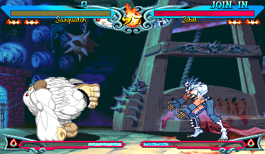

# vsav2e: Darkstalkers 3 — Vampire Savior 2 with the full roster, in English (work in progress)

Private work repository for a CPS2 bootleg of *Vampire Savior 2: The Lord of Vampire*
(MAME set `vsav2`) with the characters that only *Vampire Hunter 2* (`vhunt2`) has —
Jon Talbain, Rikuo and Sasquatch — so all 18 Darkstalkers are in one set, translated into
English with the official texts of the PlayStation *Darkstalkers 3*.

Target: a `vsav2e` entry in [mame2003-plus](https://github.com/zanac/mame2003-plus-libretro).

This repository is private: it also holds material taken from the PlayStation game.

## Layout

| Path | What |
|---|---|
| `docs/analysis.md` | measurements of the two ROM sets: what differs, what each character weighs, what can be freed |
| `make_vsav2e.py` | builds `vsav2e.zip` (program, program extension, upper sprite bank, sound program, second half of the samples) from `vsav2.zip`, `vsav.zip` and `vhunt2.zip` |
| `docs/versus.md` | the stage choice of a versus match |
| `docs/roster.md` | how Jon Talbain, Rikuo and Sasquatch are put back, the hardware it takes, how it is tested |
| `tools/build/` | the build steps (region, language, win quotes, endings, roster, select screen, title screen, sound, names, versus stage) |
| `tools/dev/*.s` | GNU as sources of the routines the build writes as hex, to check them |
| `tools/cps2/sprite_rom.py` | reads and writes tiles in the sprite ROM chips |
| `assets/psx/select/` | captures of the PlayStation select screen, one per character: the build takes the three new cells from them |
| `assets/vsav2e_title_assets.zip` | captures of the PlayStation title screen, at their paths `assets/psx/title/`: the logo (`darkstalkers3.png`) and its 8 zoom pictures (`zoom1.png`-`zoom8.png`); the build reads them from the zip, or from that folder if it is there |
| `docs/title.md` | the Darkstalkers 3 title screen |
| `tools/cps2/` | CPS2 program loader, quote text format |
| `tools/dev/install_for_mame.py` | lays the build out as MAME's `vsav2d` for testing (without the three added characters) |
| `tools/dev/libretro_run.c` | runs the set in the mame2003-plus core with scripted inputs, screenshots and memory writes |
| `docs/text.md` | where the texts are and how they are translated |
| `tools/psx/`, `docs/psx.md` | tools and notes for the PlayStation Darkstalkers 3 |
| `tools/trace/` | MAME Lua tile tracer and the scripts that drive the game (forced characters, auto-win to the endings) |
| `tools/analysis/` | Python: loads and unshuffles the CPS2 graphics, renders tile sheets, attributes tiles to characters |

## State

Done: English win quotes, endings and Jedah's speech; European region; Jon Talbain,
Rikuo and Sasquatch playable and fought as opponents, with their voices; the select
screen with all 18, laid out like the PlayStation game's (`docs/roster.md`); the
PlayStation Darkstalkers 3 title screen, with its zoom and flash (`docs/title.md`).


| | | |
|---|---|---|
|  |  |  |

Names: the Western ones (Jon Talbain, Rikuo, Lord Raptor, B.B. Hood, Hsien-Ko, Huitzil).

Versus: after picking his character, the challenger picks the stage with the portraits
(each character's stage; "?" random; ten seconds; a loser who continues starts from the
last stage; `docs/versus.md`).

Language: English by default, Japanese from the service menu (`docs/text.md`).


## Running the tracer

MAME 0.264 or later, the sets in `roms/` (`vsav2.zip`, `vhunt2.zip`; the QSound DSP ROM
`dl-1425.bin` in `roms/qsound_hle/` — a placeholder of the right size is enough, sound is
not needed). Outputs go to `work/`.

```
tools/trace/force.sh vhunt2 02 talbain      # fight as character 0x02, trace 6000 frames
tools/trace/endrun.sh vsav2 05             # auto-win to character 0x05's ending
```
