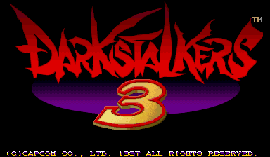

# The title screen: Darkstalkers 3

vsav2e shows the title of the PlayStation *Darkstalkers 3* in place of Vampire Savior
2's, as the PlayStation game shows it. The build step is `tools/build/title_screen.py`
(its docstring has the details); `tools/dev/title_screen.s` is the source of its routines.

## The PlayStation title, frame by frame

Measured on the disc (SLUS-00745) in the PCSX ReARMed core, one capture per frame:

| Frames | What |
|---|---|
| 1 | black (after the eye of the intro) |
| 8 | the logo grows from the middle to its full size (width 70, 128, 182, 221, 256, 288, 320, 348 of 360 pixels) |
| 16 | from the 8th zoom picture on, the whole screen whitens: 16 (of 255) more to each component on each frame, up to 248; the 15th step is shown twice |
| then | the logo still on black, about 370 frames, then the demonstration |

The pictures of the zoom are the PlayStation's own: `assets/psx/title/zoom1.png` to
`zoom8.png` (the 8th was captured with the first flash step, which the build takes off),
and `darkstalkers3.png` for the still logo. On the arcade screen (384 x 224) the
PlayStation one (364 x 240) is centred.

## In the arcade game

| What | Where |
|---|---|
| Title scene | states at `0x6b66` by `$8(a5)`: 0 set up (`0x6b80`), 2-8 the arcade's arrival, 10 the still title (`0x6cc8`), 12 its time (`$a(a5)`) |
| Layers | the blue band is in the text layer (loaded at `0x6bd0`, `0x6bde`), the outline and glow in the other two; `$32(a5)` is the layer control (0x02 text, 0x04, 0x08) |
| Logo objects | class 0x61 kinds 0x70-0x82 (arrival), 0x7e, 0x80, 0x9e-0xac (sparkles), class 0x6e kinds 0x05 (the "2"), 0x0d |
| Copyright | text layer, palette 0x1f (`0x90c7e0`), written by `0x6de2` |
| INSERT COIN | object at ff f200 (class 03 kind 0x10), y at `$14` |
| Backdrop | colour 4095 of the palettes (`0x90dffe`) |

vsav2e keeps the arcade's copyright line and INSERT COIN (moved under the logo, where
the PlayStation shows nothing); the music is the arcade's.

